<div align="center">

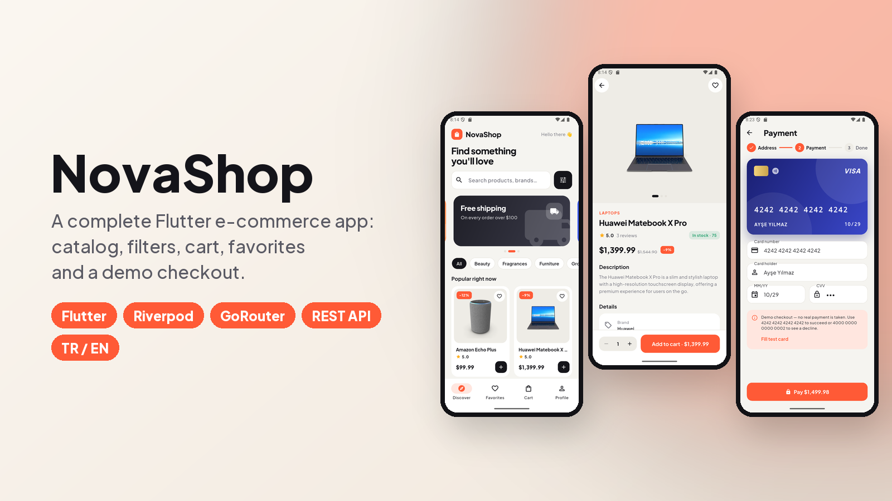

# NovaShop · Flutter E-ticaret Uygulaması

Gerçek bir mağaza uygulaması gibi çalışan bir alışveriş uygulaması:
- Arama, filtreler ve sonsuz kaydırmalı ürün kataloğu.
- Favoriler.
- Kuponlu ve cihazda saklanan sepet.
- Üç adımlı demo ödeme.

[](https://flutter.dev)
[](https://dart.dev)
[](https://riverpod.dev)
[](https://github.com/SafaSenturk/flutter-ecommerce-app/actions/workflows/ci.yml)
[](LICENSE)

**[⬇️ APK'yı indir](https://github.com/SafaSenturk/flutter-ecommerce-app/releases/latest)** · [🇬🇧 English](#-english)

</div>

---

## Demo

<p align="center">
  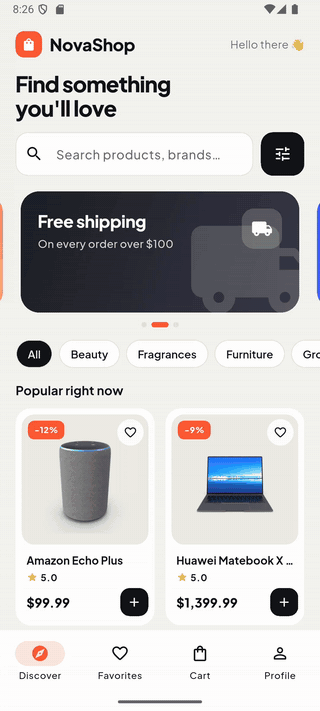
</p>

<p align="center"><i>Ürünlere göz at → ürün detayı → sepete ekle → kupon → adres → kartla ödeme → sipariş onaylandı</i></p>

## Özellikler

**Katalog**
- **Sonsuz kaydırmalı** ürün ızgarası, aşağı çekerek yenileme ve iskelet (shimmer) yükleme.
- **Gecikmeli (debounce) arama**, kategori çipleri ve kendiliğinden dönen kampanya afişleri.
- **Filtre paneli:**
  - Sıralama: önerilen, en yüksek indirim, fiyat, ad.
  - Fiyat aralığı.
  - En düşük puan.
  - Sadece stoktakiler.
- **Ürün sayfası:**
  - Görsel galerisi ve **Hero animasyonu**.
  - Stok durumu ve detaylar.
  - Müşteri yorumları.

**Sepet ve favoriler**
- Favoriler ve sepet **cihazda saklanır**; uygulama kapanıp açılsa da kaybolmaz.
- Adet değiştirme, **kaydırarak silme ve geri alma**, anlık toplam.
- Ücretsiz kargo çubuğu ve **kupon kodları** (`NOVA10`, `FLUTTER20`).

**Ödeme (demo)**
- Üç adım: doğrulamalı adres formu → kartla ödeme → onay.
- Markayı tanıyan (Visa, Mastercard, Amex, Troy) ve CVV için dönen **animasyonlu kredi kartı**.
- Gerçek dünyadaki kontroller:
  - **Luhn** algoritmasıyla kart numarası doğrulama.
  - Son kullanma tarihi kontrolü.
  - Markaya göre CVV uzunluğu.
- Test kartları:
  - `4242 4242 4242 4242` başarılı olur.
  - `4000 0000 0000 0002` reddedilir.
  - Hiçbir zaman gerçek ödeme alınmaz.
- Teslimat adresi ve ödeme özetiyle sipariş geçmişi.

**Kalite**
- **Türkçe ve İngilizce**: Profil'den değiştirilir, varsayılan olarak cihazın dilini izler.
- **Açık ve koyu tema**.
- İnternetten veri çeken her ekranda **yükleniyor, boş ve hata durumları** var, "Tekrar dene" düğmesiyle. İnternet yok, zaman aşımı ve sunucu hatası için ayrı mesajlar gösterilir.
- Testler ve CI:
  - Fiyatlandırma, sepet mantığı, filtreler ve kart doğrulama için birim testleri.
  - GitHub Actions her push'ta `analyze` ve `test` çalıştırır.

## Ekran görüntüleri

| Ana sayfa | Ürün | Filtreler | Sonuçlar |
|:---:|:---:|:---:|:---:|
| 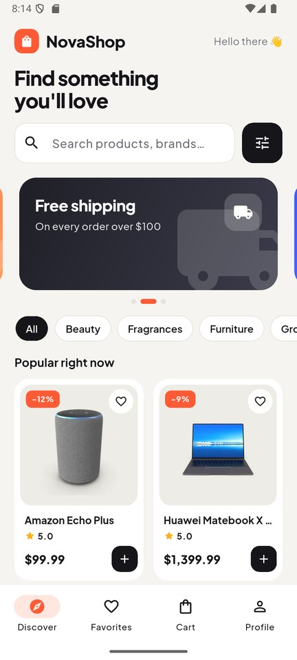 | 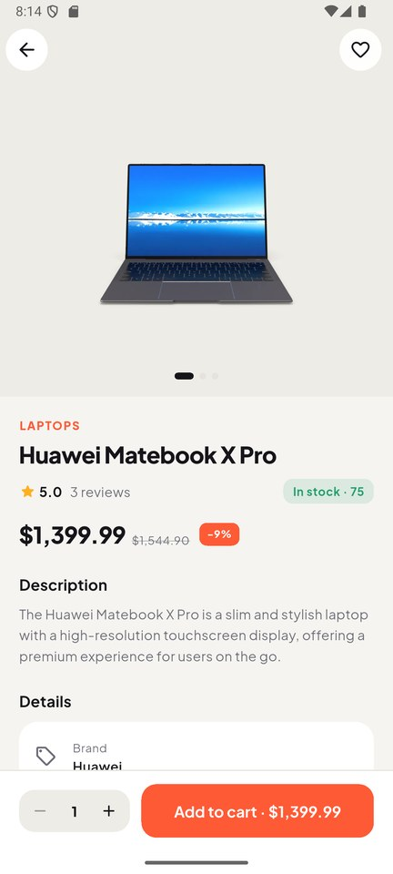 | 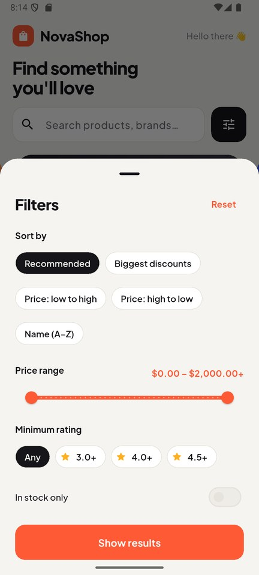 | 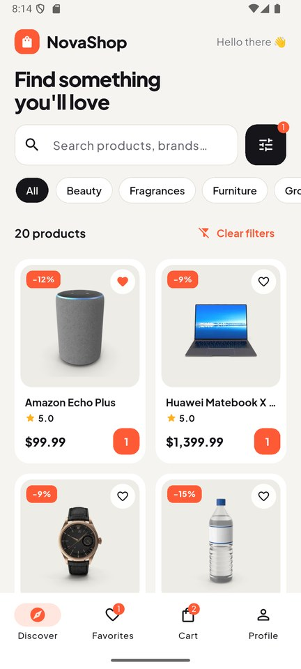 |
| **Sepet + kupon** | **Adres** | **Ödeme** | **CVV (kart döner)** |
| 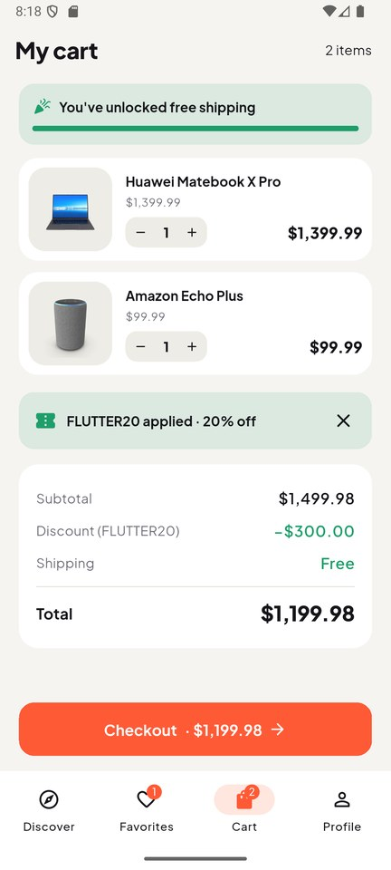 | 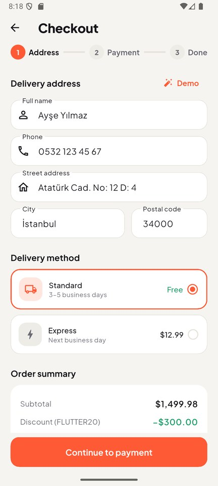 | 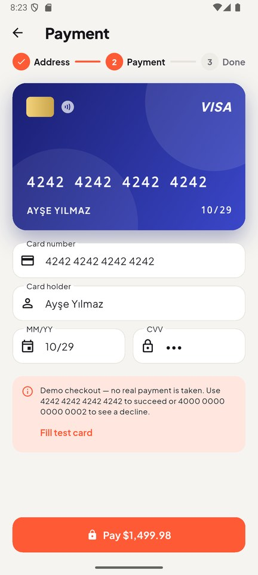 | 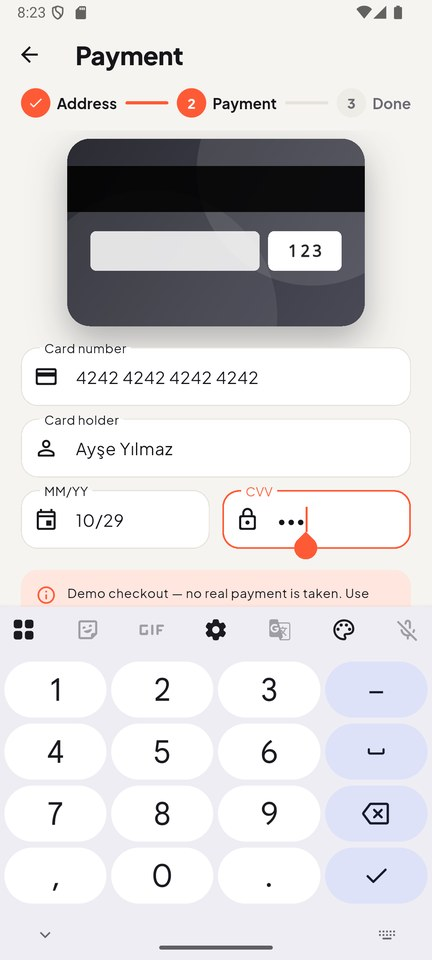 |
| **Sipariş onaylandı** | **Sipariş geçmişi** | **Koyu · Türkçe** | **Koyu · Türkçe** |
| 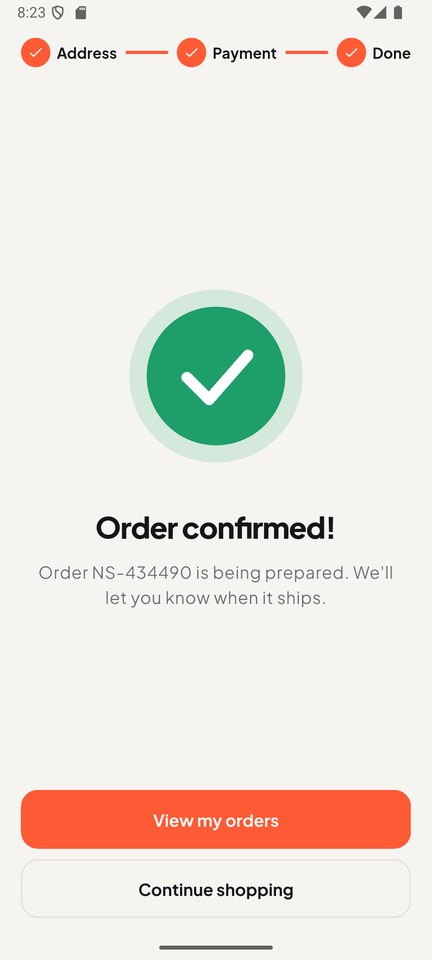 | 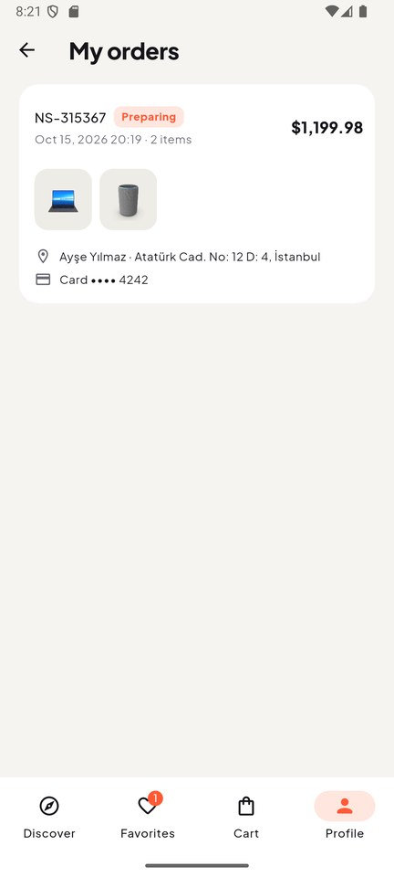 | 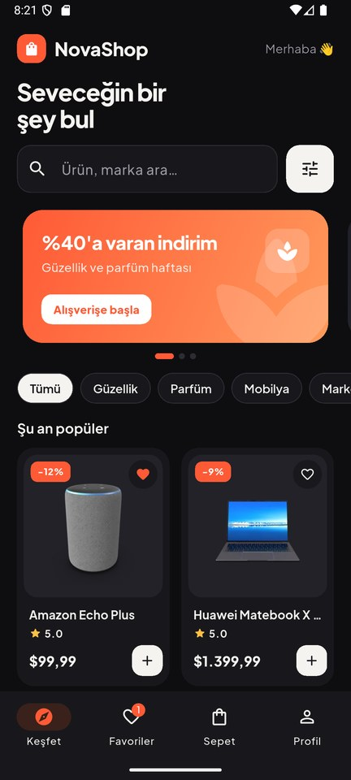 | 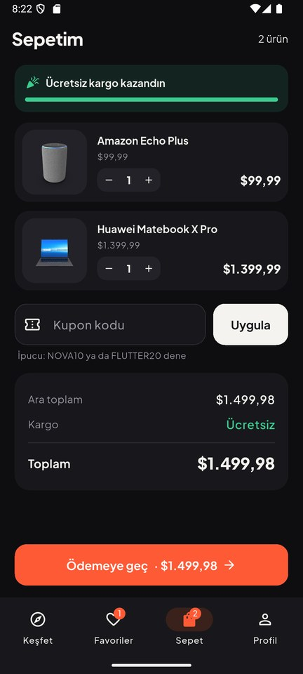 |

## Teknolojiler

| Alan | Seçim |
|---|---|
| Arayüz | Flutter 3.44, Material 3, özel tasarım token'ları (`ThemeExtension`), uygulamaya gömülü Plus Jakarta Sans |
| State management | **Riverpod 3** (`Notifier`, `AsyncNotifier`, `FutureProvider.family`) |
| Gezinme | `StatefulShellRoute` ile **go_router** (her sekme kendi geçmişini tutar), route guard'lar |
| Ağ | **Dio** + kullanıcı dostu mesajlara çevrilen tek bir `AppException` türü |
| Veri | [DummyJSON](https://dummyjson.com) ürün API'si (194 ürün, 24 kategori) |
| Saklama | `shared_preferences` (sepet, favoriler, siparişler, ayarlar) |
| Görseller | `cached_network_image` |
| Yerelleştirme | `flutter_localizations` + ARB dosyaları (`gen-l10n`), Türkçe ve İngilizce |
| Test / CI | `flutter_test`, GitHub Actions |

## Mimari

Klasörler özelliğe göre ayrılır. Her özellik üç katmanı ayrı tutar, böylece iş kuralları Flutter olmadan test edilebilir:
- **domain:** sade Dart modelleri ve mantık.
- **application:** Riverpod controller'ları.
- **presentation:** widget'lar.

```
lib/
├── main.dart                 # ProviderScope, tema, yerelleştirme, router
├── core/
│   ├── network/              # Dio istemcisi + AppException
│   ├── router/               # go_router ayarları, alt gezinme kabuğu
│   ├── storage/              # SharedPreferences provider'ı
│   ├── theme/                # Açık/koyu tema + tasarım token'ları
│   ├── utils/                # Para/tarih biçimleme, Türkçe kategori adları
│   └── widgets/              # Shimmer, hata/boş ekranlar, fiyat etiketi, adet seçici…
├── features/
│   ├── catalog/              # Ürünler: repository, sorgu + sonsuz liste, ekranlar
│   ├── cart/                 # Sepet durumu, fiyat özeti (kargo, kuponlar)
│   ├── favorites/
│   ├── checkout/             # Adres, kart doğrulama (Luhn), ödeme, onay
│   ├── orders/
│   └── settings/             # Dil ve tema, profil ekranı
└── l10n/                     # app_en.arb, app_tr.arb (+ üretilen kod)
```

**Ürün listesi nasıl çalışıyor?**
- Kullanıcının filtreleri değiştirilemez (immutable) tek bir `ProductQuery` nesnesinde durur.
- `ProductFeedNotifier` onu izler. Kategori, arama ya da sıralama değişince ilk sayfa kendiliğinden yeniden yüklenir.
- Kategori, arama ve sıralama API'ye gider; fiyat ve puan cihazda filtrelenir.
- Notifier, ekranda yeterli sayıda eşleşen ürün olana kadar yeni sayfa yüklemeye devam eder.

## Kendin çalıştır

```bash
git clone https://github.com/SafaSenturk/flutter-ecommerce-app.git
cd flutter-ecommerce-app
flutter pub get
flutter run
```

```bash
flutter test      # 19 birim testi
flutter analyze   # sıkı lint kuralları, sorun yok
```

API anahtarı gerekmez. Sürüm derlemeleri, `android/key.properties` varsa yerel anahtarla imzalanır; yoksa debug anahtarına geçer.

**Denemek için:** [Releases](https://github.com/SafaSenturk/flutter-ecommerce-app/releases/latest) sayfasından APK'yı indirip Android telefonuna kurabilirsin.

Bu tarz bir uygulamaya mı ihtiyacın var? Kendi ürünlerin, ödeme altyapın ve tasarımınla yapabilirim: **[safasenturk.github.io](https://safasenturk.github.io)**

### 🧩 Bu projeden çıkan eklentiler

Bu uygulamadaki şu parçaları başka projelerde de kullanılabilsin diye **[Plugins](https://github.com/SafaSenturk/Plugins)** reposuna ekledim. Oradan erişip kendi projene kopyalayabilirsin:

- **[flutter-payment-card](https://github.com/SafaSenturk/Plugins/tree/main/flutter-payment-card)**: Luhn, marka, son kullanma ve CVV doğrulama + CVV'de dönen animasyonlu kart.
- **[flutter-motion-kit](https://github.com/SafaSenturk/Plugins/tree/main/flutter-motion-kit)**: yükleniyor iskeleti (Shimmer), boş/hata ekranı (MessageView) ve diğer hareketli parçalar.

---

## 🇬🇧 English

**NovaShop** is a production-style shopping app:
- A product catalog with search, filters and infinite scroll.
- Favorites.
- A persistent cart with coupons.
- A three-step demo checkout.

The demo and screenshots are shown above. **[⬇️ Download the APK](https://github.com/SafaSenturk/flutter-ecommerce-app/releases/latest)**

### Features

**Catalog**
- Product grid with **infinite scroll**, pull-to-refresh and skeleton (shimmer) loading.
- **Debounced search**, category chips and an auto-rotating promo carousel.
- **Filter sheet:**
  - Sort: recommended, biggest discount, price, name.
  - Price range.
  - Minimum rating.
  - In stock only.
- **Product page:**
  - Image gallery and **Hero animation**.
  - Stock status and details.
  - Customer reviews.

**Cart & favorites**
- Favorites and cart are **saved on the device** and survive app restarts.
- Quantity stepper, **swipe to delete with undo**, live totals.
- Free-shipping progress bar and **coupon codes** (`NOVA10`, `FLUTTER20`).

**Checkout (demo)**
- Three-step flow: address form with validation → card payment → confirmation.
- **Animated credit card** that detects the brand (Visa, Mastercard, Amex, Troy) and flips to show the CVV.
- Real-world checks:
  - **Luhn** card number validation.
  - Expiry date check.
  - CVV length per brand.
- Test cards:
  - `4242 4242 4242 4242` succeeds.
  - `4000 0000 0000 0002` is declined.
  - No real payment is ever taken.
- Order history with delivery address and payment summary.

**Quality**
- **Turkish and English**: switch in Profile; follows the device by default.
- **Light and dark theme**.
- Every network screen handles **loading, empty and error states** with a retry button. Offline, timeout and server errors each get their own message.
- Tests and CI:
  - Unit tests for pricing, cart logic, filters and card validation.
  - GitHub Actions runs `analyze` and `test` on every push.

### Tech stack

| Area | Choice |
|---|---|
| UI | Flutter 3.44, Material 3, custom design tokens (`ThemeExtension`), bundled Plus Jakarta Sans |
| State management | **Riverpod 3** (`Notifier`, `AsyncNotifier`, `FutureProvider.family`) |
| Navigation | **go_router** with `StatefulShellRoute` (each tab keeps its own stack) and route guards |
| Networking | **Dio** + a single `AppException` type mapped to user-friendly messages |
| Data | [DummyJSON](https://dummyjson.com) products API (194 products, 24 categories) |
| Persistence | `shared_preferences` (cart, favorites, orders, settings) |
| Images | `cached_network_image` |
| Localization | `flutter_localizations` + ARB files (`gen-l10n`), Turkish & English |
| Testing / CI | `flutter_test`, GitHub Actions |

### Architecture

Folders are organised by feature. Each feature keeps three layers apart, so business rules can be tested without Flutter:
- **domain:** plain Dart models and logic.
- **application:** Riverpod controllers.
- **presentation:** widgets.

The folder tree is shown in the Turkish section above.

**How the product feed works**
- The user's filters live in one immutable `ProductQuery`.
- `ProductFeedNotifier` watches it, so any change (category, search, sort) automatically refetches page one.
- Category, search and sort go to the API; price and rating are filtered on the device.
- The notifier keeps loading pages until enough matching products are on screen.

### Run it yourself

```bash
git clone https://github.com/SafaSenturk/flutter-ecommerce-app.git
cd flutter-ecommerce-app
flutter pub get
flutter run
flutter test      # 19 unit tests
```

No API keys are needed. Release builds are signed with a local key when `android/key.properties` exists and fall back to debug keys otherwise.

Need an app like this, with your own products, payment provider and design? **[safasenturk.github.io](https://safasenturk.github.io)**

### 🧩 Reusable plugins from this app

These parts of the app are available in the **[Plugins](https://github.com/SafaSenturk/Plugins)** repo, ready to copy into your own project:

- **[flutter-payment-card](https://github.com/SafaSenturk/Plugins/tree/main/flutter-payment-card)**: Luhn, brand, expiry and CVV validation + the animated card that flips for the CVV.
- **[flutter-motion-kit](https://github.com/SafaSenturk/Plugins/tree/main/flutter-motion-kit)**: loading skeletons (Shimmer), empty/error views (MessageView) and other motion widgets.

---

<div align="center">

**[Safa Şentürk](https://github.com/SafaSenturk)** · Flutter Mobil Geliştirici · Flutter Mobile Developer · [Portföy / Portfolio](https://safasenturk.github.io)

<sub>Ürün verileri ve görselleri herkese açık <a href="https://dummyjson.com">DummyJSON</a> API'sinden gelir ve yalnızca tanıtım amaçlı kullanılır. · Product data and images come from the public DummyJSON API and are used for demonstration only.</sub>

</div>
